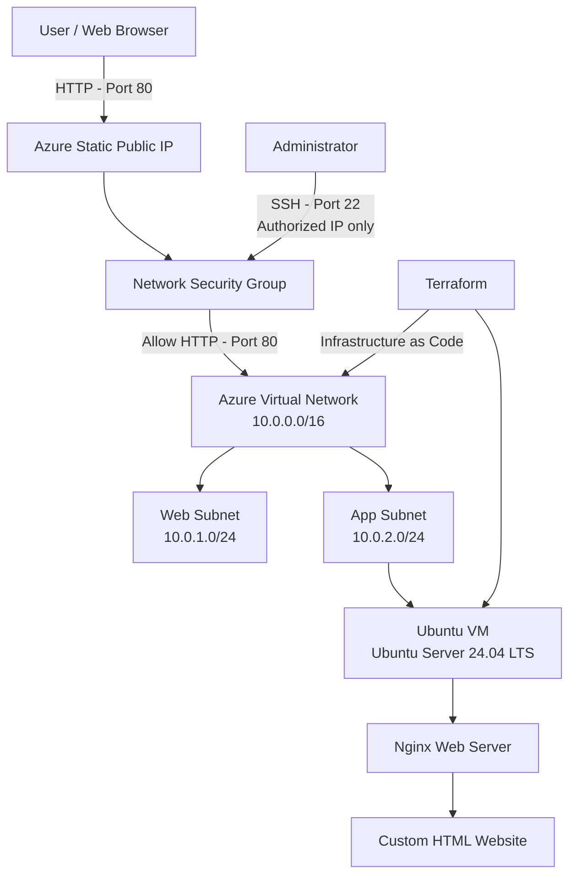

# Azure Cloud Migration — Architecture

## Architecture Overview

This diagram illustrates the Azure infrastructure deployed using Terraform and the flow of HTTP traffic to the hosted website.

## Component Descriptions

| Component | Purpose |
|---|---|
| Azure Public IP | Provides a public endpoint for accessing the website |
| Network Security Group | Controls inbound network traffic |
| Virtual Network | Provides an isolated Azure network |
| Web Subnet | Reserved subnet for web-tier resources |
| App Subnet | Hosts the Ubuntu virtual machine |
| Ubuntu VM | Provides the Linux hosting environment |
| Nginx | Serves the website over HTTP |
| Terraform | Provisions and manages infrastructure |

## Network Security

- HTTP traffic is permitted through port 80.
- SSH administrative access uses port 22 and is restricted to an authorized IP address.
- SSH authentication uses an SSH key rather than a password.

## Deployment Notes

- Infrastructure is provisioned using Terraform.
- The Ubuntu virtual machine runs Nginx.
- The custom HTML website is hosted on the virtual machine.
- HTTPS and additional cloud-native improvements are planned.
